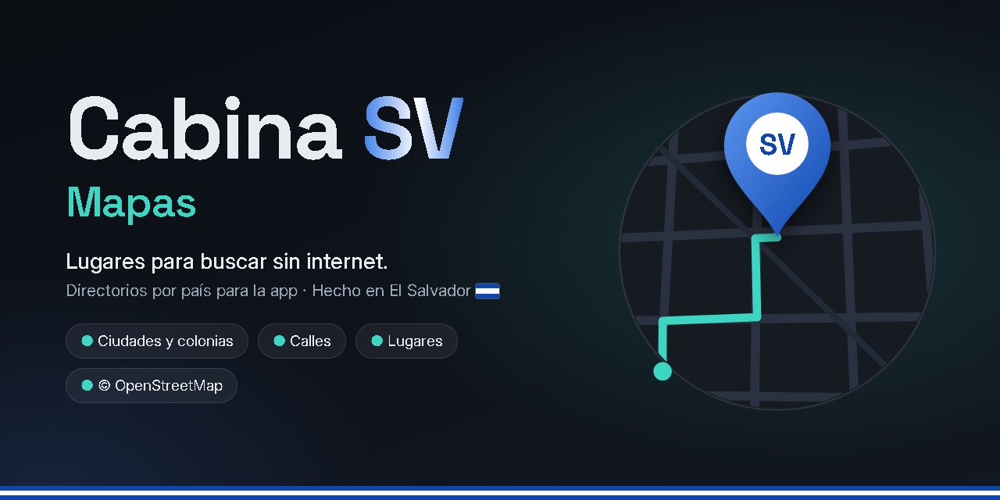

  

# Cabina SV · Mapas

Directorios de lugares por país para buscar **sin internet** en la app **Cabina SV**. La app los descarga desde aquí cuando eliges un país en Ajustes.

## Países

| País | Lugares | Tamaño |
|---|---|---|
| 🇸🇻 **El Salvador** | 41,151 | 1.1 MB · *incluido en la app* |
| 🇬🇹 Guatemala | 52,978 | 1.5 MB |
| 🇭🇳 Honduras | 34,608 | 0.9 MB |
| 🇳🇮 Nicaragua | 39,552 | 1.1 MB |
| 🇨🇷 Costa Rica | 108,841 | 2.9 MB |
| 🇵🇦 Panamá | 35,703 | 1.0 MB |

Incluyen ciudades, colonias y barrios, calles, aeropuertos y lugares de interés (gasolineras, hospitales, tiendas, restaurantes…).

🇸🇻 **El Salvador ya viene incorporado en la app**: Cabina SV nació aquí, es la app de nuestro país, así que su directorio está listo desde que la instalas, sin descargar nada. Los demás países se descargan desde este repositorio cuando los necesites.

## Rutas sin internet

Archivos para que la app calcule el camino sin datos móviles. Se descargan una sola vez desde la app (Ajustes > Navegación), igual que los directorios de lugares.

| País | Descarga | Ya instalado |
|---|---|---|
| 🇸🇻 El Salvador | 12.6 MB | 27 MB |

🔜 La app empezará a usarlos para navegar en su próxima actualización.

Los archivos están en la sección [**Releases**](../../releases/latest). `paises.json` lista los países disponibles.

## Privacidad

[Política de privacidad de Cabina SV](https://patinorafa04-ship-it.github.io/cabina-sv-mapas/privacidad.html)

## Datos y licencia

Los datos son © colaboradores de [OpenStreetMap](https://www.openstreetmap.org/copyright) y están disponibles bajo la licencia [Open Database License (ODbL) 1.0](https://opendatacommons.org/licenses/odbl/1-0/). Ver [LICENSE](LICENSE).

Si encuentras un lugar con el nombre equivocado o que falta, puedes corregirlo directamente en [openstreetmap.org](https://www.openstreetmap.org). La corrección aparecerá en la siguiente actualización de estos directorios.

---

Hecho en El Salvador 🇸🇻 por Rafael Aguilar.
